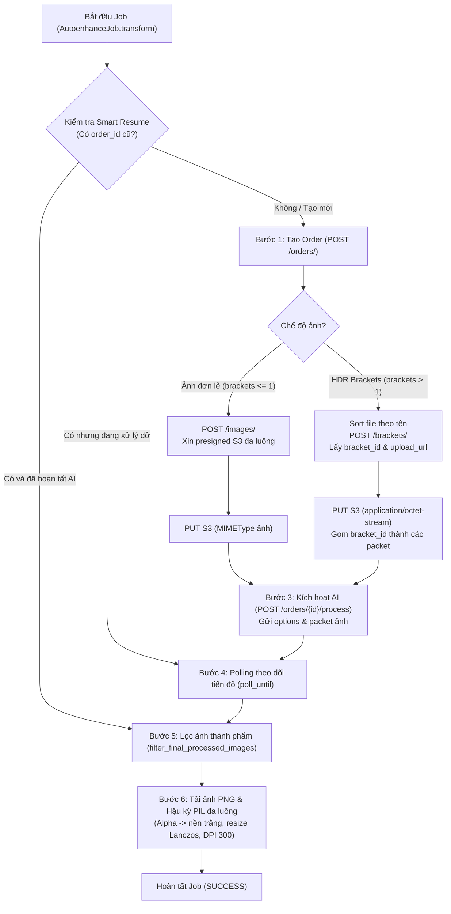

# Workflow Tổng Thể Autoenhance Engine v3 (Kiến Trúc & Quy Trình Chi Tiết)

Tài liệu này mô tả chi tiết toàn bộ vòng đời (lifecycle), luồng dữ liệu (data flow), kiến trúc đa luồng, cơ chế xử lý HDR Brackets và hậu kỳ ảnh của **Autoenhance Engine v3** trong hệ thống `autohdr_exe`.

---

## 1. Tổng Quan Kiến Trúc (Architecture Overview)

Autoenhance Engine v3 được đóng gói theo mô hình hướng đối tượng độc lập, kế thừa `BaseExecutor`, tích hợp cơ chế Smart Resume, đa luồng hoá `run_parallel`, tự động thử lại khi gặp giới hạn tốc độ (Smart Retry & Backoff), và hỗ trợ 2 chế độ xử lý: **Single Image (Ảnh đơn lẻ)** và **HDR Brackets (Ghép nhiều ảnh chênh sáng)**.

### Sơ đồ luồng tổng thể (Mermaid Diagram)



---

## 2. Chi Tiết Các Bước Nghiệp Vụ (Step-by-Step Breakdown)

### Bước 0: Chuẩn bị & Đo kích thước (`_read_image_dimensions`)
* **Mục đích:** Trước khi upload, app đọc kích thước gốc (width, height) của từng file ảnh đầu vào và lưu vào `context.meta_dims`.
* **Ý nghĩa:** Đảm bảo sau khi AI Autoenhance xử lý và xuất ra ảnh PNG, bước hậu kỳ PIL có thể resize Lanczos đưa ảnh về đúng kích thước pixel gốc của máy ảnh.

---

### Bước 1: Tạo đơn hàng mới (`_step_create_order`)
* **Endpoint:** `POST https://api.autoenhance.ai/v3/orders/`
* **Headers:** `{"x-api-key": "<API_KEY>", "Content-Type": "application/json"}`
* **Payload:**
  ```json
  {
    "order_id": "b4e9b8dc-976d-4bad-92bc-2474684c723c",
    "name": "Job_job_8295e245_17945743"
  }
  ```
* **Quy chuẩn v3:** Client chủ động sinh `order_id` dưới dạng UUID v4 và đặt `name` để dễ quản lý.
* Order ID này được lưu vào `context.remote_job_id` và `context.extra_data["order_id"]` để phục vụ Smart Resume nếu xảy ra sự cố giữa chừng.

---

### Bước 2: Phân luồng Upload & Đa luồng S3 (`_step_upload_files`)

Hệ thống tự động phân tách theo `number_of_brackets_per_image`:

#### Trường hợp A: HDR Brackets (`number_of_brackets_per_image > 1`)
1. **Sắp xếp thứ tự file:** Luôn sắp xếp danh sách file theo thứ tự bảng chữ cái (`sorted_files = sorted(ready_files, key=lambda f: f.name)`) để đảm bảo các frame cùng một góc chụp (`DSC09322` .. `DSC09326`) luôn nằm liền kề nhau.
2. **Đăng ký Bracket:**
   * **Endpoint:** `POST https://api.autoenhance.ai/v3/brackets/`
   * **Payload:** `{"order_id": order_id, "name": file_path.name}`
   * **Response:** Trả về `bracket_id` và `upload_url`.
3. **Cơ chế Packet Grouping:**
   * Giữ nguyên thứ tự file ban đầu, gom các `bracket_id` tương ứng thành từng packet có kích thước đúng bằng `number_of_brackets_per_image`.
   * Ví dụ: 10 file ảnh với bracket = 5 sẽ được chia thành:
     ```python
     context.extra_data["bracket_packets"] = [
         ["id_DSC09322", "id_DSC09323", "id_DSC09324", "id_DSC09325", "id_DSC09326"],
         ["id_DSC09327", "id_DSC09328", "id_DSC09329", "id_DSC09330", "id_DSC09331"]
     ]
     ```
4. **Upload S3:** Thực hiện `PUT upload_url` với `Content-Type: application/octet-stream`.

#### Trường hợp B: Single Image Mode (`number_of_brackets_per_image <= 1` hoặc không cấu hình)
1. **Endpoint:** `POST https://api.autoenhance.ai/v3/images/`
2. **Payload:** `{"order_id": order_id, "image_name": file_path.name}`
3. **Upload S3:** Thực hiện `PUT s3PutObjectUrl` với Content-Type tương ứng (`image/jpeg` hoặc `image/png`).

#### Cơ chế Đa luồng & Smart Retry (Chung cho cả 2 trường hợp):
* **Song song hoá:** Thực hiện qua `run_parallel` với `max_upload_workers = 4`.
* **Xử lý Rate Limit (HTTP 429):** Đọc header `Retry-After` (mặc định thử lại sau `attempt + 2` giây).
* **Xử lý lỗi máy chủ tạm thời (HTTP 5xx):** Thử lại tối đa 3 lần với Linear Backoff (chờ 1s, 2s).
* **Fail-Fast lỗi Client (HTTP 4xx):** Dừng ngay lập tức nếu gặp 400, 401, 403, 404 (không retry vô ích khi sai xác thực hoặc sai tham số).

---

### Bước 3: Kích hoạt xử lý AI (`_step_trigger_process`)
* **Endpoint:** `POST https://api.autoenhance.ai/v3/orders/{order_id}/process`
* **Cấu trúc Payload:**
  ```json
  {
    "ai_version": "latest",
    "enhancement_style": "natural",
    "sky_replacement": true,
    "cloud_type": "WHISPY_CLOUD",
    "perspective_correction": false,
    "perspective_correction_mode": null,
    "privacy": true,
    "lens_correction": true,
    "window_pull": false,
    "window_pull_type": "ONLY_WINDOWS",
    "contrast_boost": null,
    "saturation_level": null,
    "upscale": false,
    "restage": {
      "tvs": "BLACK_OUT",
      "fire_in_fireplaces": "ALIGHT",
      "photographer": "REMOVE",
      "environment": "AS_SHOT",
      "grass": "GREEN"
    },
    "images": [
      {
        "bracket_ids": ["id_1", "id_2", "id_3", "id_4", "id_5"]
      },
      {
        "bracket_ids": ["id_6", "id_7", "id_8", "id_9", "id_10"]
      }
    ]
  }
  ```
* **Quy tắc vàng về Grouping:**
  * Nếu có `bracket_packets`: Gửi mảng `images` chứa danh sách `bracket_ids` cho từng ảnh thành phẩm (Explicit Grouping). Tuyệt đối **không gửi kèm** `number_of_brackets_per_image` để tránh lỗi HTTP 422 `Conflicting grouping options`.
  * Nếu không có `bracket_packets` (ví dụ chạy Resume order cũ): Fallback gửi `number_of_brackets_per_image`.

---

### Bước 4: Thăm dò tiến độ hoàn tất (`_step_poll_completion`)
* **Hàm thực thi:** `poll_order_completion` (sử dụng tiện ích `poll_until`).
* **Chu kỳ kiểm tra:** Mỗi `5` giây một lần (`DEFAULT_POLL_INTERVAL`), tối đa chờ `1800` giây (`DEFAULT_MAX_WAIT_SECONDS`).
* **Trạng thái thăm dò:**
  * Gọi `GET https://api.autoenhance.ai/v3/orders/{order_id}`.
  * Đếm số ảnh hoàn thành: `[img for img in raw_data.get("images", []) if str(img.get("status", "")).lower() == "processed"]`.
  * Cập nhật tiến độ % động lên giao diện qua `context.set_step("polling", ..., progress_pct=55..75)`.
  * Hỗ trợ dừng tức thì (0ms latency) khi người dùng bấm nút Hủy trên UI thông qua `context.stop_event`.

---

### Bước 5: Lọc ảnh thành phẩm cuối cùng (`filter_final_processed_images`)
* **Vị trí tích hợp:** Thực hiện ngay đầu hàm `download_order_images`.
* **Vấn đề giải quyết:** Khi đơn hàng hoàn tất, Autoenhance có thể lưu cả ảnh draft/sơ bộ lẫn ảnh HDR gộp (`Manually Grouped`). Nếu tải tất cả sẽ bị lỗi tải gấp đôi hoặc tải ảnh thô chưa gộp.
* **Cơ chế lọc 2 tầng:**
  1. **Tầng 1 (Tra cứu Brackets):** Gọi `GET https://api.autoenhance.ai/v3/orders/{order_id}/brackets`. Lấy tập hợp `target_ids = {b['image_id'] for b in brackets if b.get('image_id')}`. Chỉ giữ lại những ảnh có `image_id` nằm trong danh sách này.
  2. **Tầng 2 (Heuristic Fallback):** Nếu không truy vấn được brackets, ưu tiên các ảnh có metadata `{"Manually Grouped": False}` hoặc có `preset_id`, sau đó khử trùng lặp theo tên file và lấy ảnh có `date_added` mới nhất.

---

### Bước 6: Tải ảnh thành phẩm & Hậu kỳ PIL (`_step_download_and_process`)
* **URL tải ảnh gốc chất lượng cao (không watermark):**
  ```text
  GET https://api.autoenhance.ai/v3/images/{image_id}/enhanced?format=png&watermark=false&preview=true&quality=90&scale=1&max_width=8192
  ```
* **Cơ chế chống ghi đè tên file (Anti-collision unique naming):**
  * Tự động ánh xạ và tăng chỉ số: `DSC09322.jpg`, `DSC09322_1.jpg`... nếu có các ảnh trùng tên.
  * Lưu ánh xạ vào `context.extra_data["ae_download_map"]` để khi resume không bị đổi tên file.
* **Smart Resume cấp độ file:**
  * Trước khi tải file, kiểm tra nếu `dest_file.is_file()` và kích thước `> 0 byte`, app sẽ ghi log `[RESUME] Bỏ qua tải` và tái sử dụng file cũ, tiết kiệm băng thông.
* **Hậu kỳ cục bộ PIL (`apply_pil_postprocess`):**
  1. Đè kênh Alpha trong suốt lên nền màu trắng (`RGB(255, 255, 255)`).
  2. Resize theo thuật toán Lanczos đưa ảnh về đúng kích thước pixel gốc đã lưu tại Bước 0 (`context.meta_dims`).
  3. Xuất file ảnh định dạng JPEG chất lượng cao, thiết lập DPI chuẩn `300`.
  4. Tự động dọn dẹp file tạm `.temp_{img_id}.png`.

---

## 3. Cơ Chế Khôi Phục Thông Minh (Smart Resume Lifecycle)

Khi một Job bị dừng hoặc chạy lại với Order ID cũ (`context.remote_job_id`):

```text
Kiểm tra fetch_order_status(order_id)
 ├── Order đã hoàn tất đủ ảnh trên Cloud:
 │    └── Nhảy thẳng tới Bước 5 & 6 (Download & Post-process). Bỏ qua hoàn toàn Upload và Process!
 ├── Order đang xử lý dở dang:
 │    └── Nhảy tới Bước 4 (Polling) để chờ AI server hoàn tất rồi tự động Download.
 └── Order không tồn tại / Lỗi:
      └── Khởi tạo đơn hàng mới từ Bước 1.
```

---

## 4. Bảng Tra Cứu Các File Liên Quan (Reference Map)

| Thành phần | Đường dẫn file | Nhiệm vụ chính |
| :--- | :--- | :--- |
| **Constants & Endpoints** | [`autohdr_exe/1tm/libs/constants/autoenhance.py`](file:///d:/workspace/fl-u01-viet/autohdr_exe/1tm/libs/constants/autoenhance.py) | Khai báo API Base URL, `/orders/`, `/brackets/`, `/images/`, `/process`. |
| **Job Executor** | [`autohdr_exe/1tm/jobs/autoenhance.py`](file:///d:/workspace/fl-u01-viet/autohdr_exe/1tm/jobs/autoenhance.py) | Điều phối luồng `transform()`, upload S3 đa luồng, packet grouping. |
| **Download Executor** | [`autohdr_exe/1tm/jobs/autoenhance_download.py`](file:///d:/workspace/fl-u01-viet/autohdr_exe/1tm/jobs/autoenhance_download.py) | Thực thi tải ảnh trực tiếp từ Order ID có sẵn. |
| **Business Utilities** | [`autohdr_exe/1tm/libs/utils/autoenhance.py`](file:///d:/workspace/fl-u01-viet/autohdr_exe/1tm/libs/utils/autoenhance.py) | Polling trạng thái, `filter_final_processed_images`, PIL postprocess. |
| **Unit & Integration Tests** | [`autohdr_exe/1tm/tests/test_jobs.py`](file:///d:/workspace/fl-u01-viet/autohdr_exe/1tm/tests/test_jobs.py) | Bộ test 16 bài kiểm thử tích hợp (Mocked network, packet grouping, filter). |

